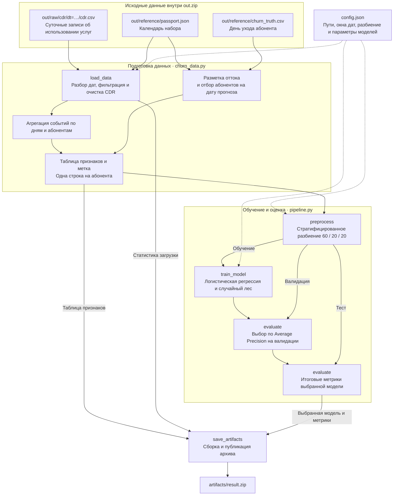

# Архитектура конвейера прогнозирования оттока

`pipeline.py` запускает конвейер по настройкам из `config.json`. По умолчанию он читает `data/out.zip` и сохраняет модель, метрики и таблицу признаков в `artifacts/result.zip`. Входной архив можно указать через `--archive`.

## Граница между историей и прогнозом

При стандартной конфигурации признаки строятся по событиям **с 1 октября по 29 ноября 2025 года включительно**. Учитываются только записи, поступившие до начала **30 ноября**. Даты ISO и даты вида `день.месяц.год` разбираются по явным форматам. Пропущенные и нечитаемые суточные файлы отражаются в журнале и отчёте о качестве.

В выборку входят абоненты с доступными записями CDR, которые ещё не ушли к дате прогноза. Метка равна 1 для ухода **с 30 ноября по 29 декабря включительно**. День ухода используется для отбора и разметки выборки. Модели получают восемь признаков из CDR.

## Хранение результатов

| Файл внутри `artifacts/result.zip` | Содержимое |
| --- | --- |
| `features.parquet` | Ключ абонента, признаки и метка оттока. |
| `model.joblib` | Выбранная модель. Для логистической регрессии в объект входит масштабирование, обученное на тренировочной выборке. |
| `metrics.json` | Метрики обеих моделей на валидации, метрики выбранной модели на тесте, порог, размеры выборок и список признаков. |
| `data_quality.json` | Границы периодов, пропущенные и нечитаемые дни, счётчики обработки CDR и отбора абонентов. |

Промежуточные таблицы хранятся в памяти. Готовый архив сначала записывается во временный файл в каталоге результатов, затем одним действием заменяет `result.zip`. Повторный запуск пишет по тому же пути. При ошибке до замены предыдущий архив остаётся доступен.
 